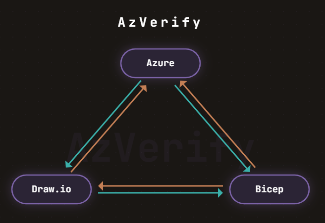

# AzVerify

Your Azure architecture diagram, Bicep templates, and deployed Azure environment are separate sources of truth. AzVerify provides GitHub Copilot skills to create and compare them, and to check Bicep templates against Azure Policy before deployment.



## Quick Start

1. Clone this repository and open its root folder in VS Code:
   ```text
   git clone https://github.com/Ba4bes/AzVerify.git
   ```
2. Sign in to GitHub Copilot Chat. Skills in `.github/skills/` are discovered from the workspace.
3. For diagram workflows, install the [Draw.io VS Code extension](https://marketplace.visualstudio.com/items?itemName=hediet.vscode-drawio). Configure the [Draw.io MCP server](https://mcp.draw.io/mcp) and, for Azure workflows, the [Azure MCP server](https://github.com/microsoft/mcp/tree/main/servers/Azure.Mcp.Server) for the best experience.
4. Authenticate to Azure before running a skill that reads or checks a live Azure scope.
5. Try a skill in Copilot Chat:
   ```text
   /azv-azure-to-diagram Resource Group `<your-resource-group>`, Subscription `<your-subscription-id>`
   ```

See [Getting Started](docs/getting-started.md) for setup details and [Example Prompts](docs/example-prompts.md) for prompts covering every skill.

## Skills

Invoke a skill in Copilot Chat with its slash command. Azure-backed skills need an authenticated Azure session and a target resource group or subscription.

### Create diagrams and Bicep

| Skill | What it does |
|-------|-------------|
| [`azv-azure-to-diagram`](.github/skills/azv-azure-to-diagram/SKILL.md) | Discover a live Azure scope and produce a Draw.io architecture diagram. |
| [`azv-azure-to-bicep`](.github/skills/azv-azure-to-bicep/SKILL.md) | Reverse-engineer a live Azure scope into modular Bicep templates, parameter files, and dependency documentation. |
| [`azv-sketch-to-diagram`](.github/skills/azv-sketch-to-diagram/SKILL.md) | Turn an architecture sketch or text description into a Draw.io Azure diagram. |
| [`azv-diagram-to-bicep`](.github/skills/azv-diagram-to-bicep/SKILL.md) | Generate modular Bicep and deployment scripts from a Draw.io diagram, with a parameter file and pre-deployment verification. |

### Compare and validate

| Skill | What it does |
|-------|-------------|
| [`azv-bicep-drift-detection`](.github/skills/azv-bicep-drift-detection/SKILL.md) | Compare Bicep with its Draw.io design (offline) or a live Azure scope (including tracked properties), then guide drift resolution. |
| [`azv-diagram-drift-detection`](.github/skills/azv-diagram-drift-detection/SKILL.md) | Compare a Draw.io diagram with live Azure in quick (resource existence) or deep (property-level) mode, then guide drift resolution. |
| [`azv-bicep-policy-check`](.github/skills/azv-bicep-policy-check/SKILL.md) | Evaluate Bicep resources against Azure Policy assignments at a target scope before deployment. |

The two drift-detection skills replace the former diagram-sync and Bicep what-if/sync skills. Bicep drift detection parses templates and compares resource models; it does not run `az deployment ... what-if`.

## Shared tooling

The reusable resource-model parsers, filters, Azure discovery, comparison logic, and fixture checks live in [`.github/skills/shared/scripts/`](.github/skills/shared/scripts/), with shared resource metadata and workflow procedures alongside them. The PowerShell scripts prefer PowerShell 7 (`pwsh`); Windows PowerShell 5.1 is also supported. Bicep parsing uses `az bicep` or the standalone Bicep CLI. Individual skills document their fallbacks when a tool is unavailable.

## Examples
The [examples/](examples/) folder contains inputs and generated outputs—Draw.io diagrams, Bicep templates, parameter files, and selected verification or drift reports—from four Azure scenarios.

| Example Directory | What it demonstrates |
|-------------------|---------------------|
| [Contoso Voting](examples/azure-to-diagram-contoso-voting/) | Live App Service deployment reverse-engineered into a diagram and Bicep. |
| [Resource Group 01](examples/sketch-to-diagram-resourcegroup01/) | Sketch-to-diagram-to-Bicep workflow with drift and policy reports. |
| [Secure Web App](examples/description-to-diagram-securewebapp/) | Text-described WAF-protected web app, diagram, and Bicep. |
| [Contoso Notify](examples/azure-to-diagram-contoso-notify/) | Function App reverse-engineering with Bicep, drift, and policy reports. |

## Documentation

| Document | Purpose |
|----------|---------|
| [Getting Started](docs/getting-started.md) | Prerequisites, MCP setup, and first skill walkthrough. |
| [Example Prompts](docs/example-prompts.md) | Copy-and-edit prompts for each skill. |
| [Test Run Tracker](docs/test-run-tracker.md) | Recorded skill test runs and results. |

## Contributing

### Maintainer tests

**When to run:** Run these functional tests before a pull request is merged, not after every change or commit. They take time, consume GitHub Copilot credits, and require the dedicated Azure test environment. Keep execution manual and opt-in rather than triggering the full suite on every edit or push.

The [`test/`](test/) folder contains an [opt-in functional test procedure](test/functional-testing.md), fixture assets (baseline and complex), helper scripts, and retained reports/artifacts. These are maintainer integration tests, **not a product skill or a normal user workflow**. They make Azure changes and should not be run against production or a general-purpose subscription.

To run them, provide:

- A dedicated Azure test subscription with existing resource groups named **`AzVerify1` and `AzVerify2`** in **`swedencentral`**. The harness now uses both a baseline storage fixture and a multi-resource complex fixture (networking, identity, Key Vault, storage, optional monitoring, and VNet peering), so these groups must be treated as disposable test scopes. The current policy probe allows only `northeurope`, so the tested resource must be in a different region. Existing policy assignments must not interfere with the baseline.
- An authenticated Azure CLI identity authorized to read both groups, create/validate deployments, create and update the storage fixture, read built-in policy definitions, call Policy Insights `checkPolicyRestrictions`, and create/delete resource-group policy assignments. Contributor alone does not grant policy-assignment management; Resource Policy Contributor or equivalent permissions are also required at the test scope.
- PowerShell 7, Azure CLI, and Bicep CLI; GitHub Copilot with workspace custom-agent support; and the Draw.io and Bicep/Azure best-practice/schema MCP integrations required by the skills for full coverage. Missing integrations must be reported as PARTIAL or BLOCKED where applicable, not silently counted as passing.
- Explicit authorization for the chosen subscription and both groups, including complex fixture deployment, reversible Hot/Cool tier changes, and a temporary deny-policy assignment in `AzVerify2`. Budget for Azure charges: the harness intentionally retains tagged fixtures for repeatability; temporary policy assignments must always be removed after each run.

Only after preparing that environment, manually select the [`azv-functional-testing` custom agent](.github/agents/azv-functional-testing.agent.md) in Copilot and explicitly authorize the run with your subscription ID. Automatic model invocation is disabled. The agent follows `test/functional-testing.md`, records failures and suggested fixes without changing product skills, and writes reports to `test/reports/` and generated outputs to `test/artifacts/<run-id>/`.

Draw.io MCP should be available for full sketch/diagram branch coverage, but the harness also verifies the raw-file fallback path when MCP is unavailable in a given runtime.

This project welcomes contributions and suggestions.  Most contributions require you to agree to a
Contributor License Agreement (CLA) declaring that you have the right to, and actually do, grant us
the rights to use your contribution. For details, visit [Contributor License Agreements](https://cla.opensource.microsoft.com).

When you submit a pull request, a CLA bot will automatically determine whether you need to provide
a CLA and decorate the PR appropriately (e.g., status check, comment). Simply follow the instructions
provided by the bot. You will only need to do this once across all repos using our CLA.

This project has adopted the [Microsoft Open Source Code of Conduct](https://opensource.microsoft.com/codeofconduct/).
For more information see the [Code of Conduct FAQ](https://opensource.microsoft.com/codeofconduct/faq/) or
contact [opencode@microsoft.com](mailto:opencode@microsoft.com) with any additional questions or comments.

## Trademarks

This project may contain trademarks or logos for projects, products, or services. Authorized use of Microsoft
trademarks or logos is subject to and must follow
[Microsoft's Trademark & Brand Guidelines](https://www.microsoft.com/legal/intellectualproperty/trademarks/usage/general).
Use of Microsoft trademarks or logos in modified versions of this project must not cause confusion or imply Microsoft sponsorship.
Any use of third-party trademarks or logos are subject to those third-party's policies.
